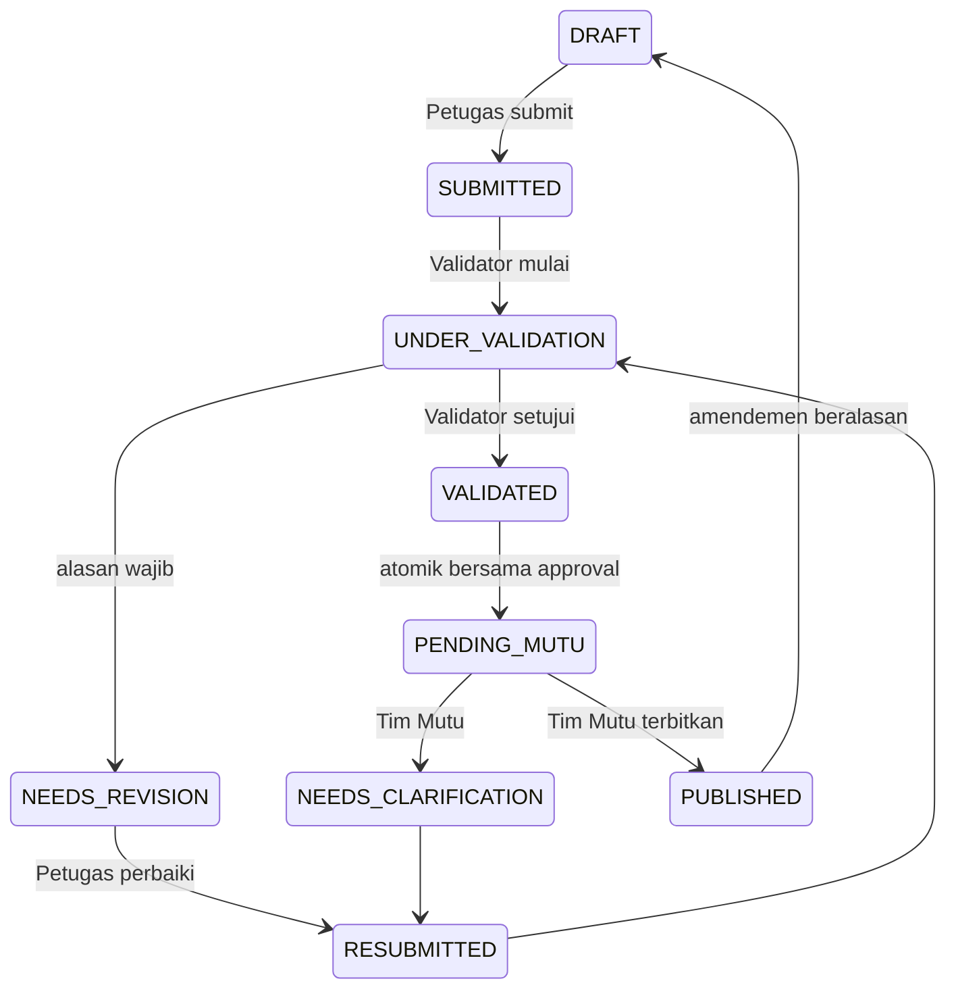

# Audit sebelum upgrade dan arsitektur perubahan

Audit dilakukan pada commit `99837e3` (main), sebelum mengubah aplikasi.

| Modul lama | Temuan | Dipertahankan |
| --- | --- | --- |
| `src/app/App.tsx`, `Layout.tsx` | SPA React Router, sidebar RSAS, filter global | Semua 12 rute lama, identitas visual dan logo; tambah akses `/legacy` |
| `src/types/index.ts` | 34 master, monthly record proporsi, empat persona lokal | Skema v1 tidak diubah |
| `src/app/store.tsx`, `lib/storageService.ts` | Satu envelope localStorage, revisi lintas tab, pemulihan JSON rusak | Key `rsas-quality-monitor:v1:dataset` dan mekanisme pemulihan tetap utuh |
| `features/entries`, `pages/Input`, `Verification` | Draft, autosave, pengajuan dan verifikasi lokal | Tetap dapat diakses sebagai arsip lokal; tidak dianggap persetujuan server |
| `features/analytics`, `reports`, `Charts`, `Dashboard` | Rasio tertimbang, kelayakan, snapshot, grafik Recharts | Seluruh logika dan pengujian lama tetap dijalankan |
| `lib/importExportService`, `Transfer` | Backup, restore, deduplikasi, konflik JSON, CSV | Tidak diganti; migrasi baru menyalin sebagai draft setelah preview |
| `pages/Actions`, `Master`, `Help` | RCA/PDCA, penugasan, simulasi opt-in | Tetap tersedia; data lama tidak dihapus |
| Infrastruktur | Vite, Node 22+, TypeScript, Tailwind, Vercel SPA; belum ada backend/Auth | Stack frontend tetap; backend baru bersifat tambahan |

Backend sebelumnya tidak ada. Karena itu otorisasi/sinkronisasi resmi ditambahkan melalui Supabase, bukan mengandalkan persona lama. Provider arsip hanya dimuat pada rute lama, sehingga storage v1 yang rusak tidak menghalangi login backend.

## Perubahan file dan tanggung jawab

- `src/features/workflow/types.ts`, `rules.ts`: tipe baru terpisah dari v1; formula whitelist, perbandingan target, agregasi sebanding, gap data, p chart bersyarat, CSV.
- `supabase/migrations/202611120001_workflow.sql`: tabel, constraints, indexes, RLS, RPC transaksional, revisi, audit, Storage privat, notifikasi, metrik agregat, publikasi Realtime.
- `supabase/migrations/202611120002_legacy_master.sql`: salinan master sumber tanpa pengukuran; semua indikator belum aktif sampai konfigurasi disahkan. Generator deterministik berada di `scripts/generate-master-seed.mjs`.
- `supabaseRepository.ts`: Auth SDK, RPC, pembacaan seluruh halaman PostgREST, signed URL, subscription, token idempotensi. Tidak ada service key.
- `demoRepository.ts`: latihan sintetis yang terpisah; tidak dipakai saat backend diminta/dikonfigurasi. Tidak mensimulasikan sinkronisasi lintas perangkat sebagai keberhasilan produksi.
- `WorkflowProvider.tsx`: sesi, pemuatan ulang yang aman dari respons kedaluwarsa, Realtime serta polling cadangan.
- `src/pages/workflow/`: shell sesuai role, input/pengajuan/detail/riwayat, dua inbox, analitik/laporan, RCA, master/unit/role, audit dan migrasi.
- `.env.example`, `supabase/config.toml`, `vercel.json`, `scripts/check-public-env.mjs`: konfigurasi tanpa credential dan pencegahan build dengan secret/service-role key.
- `supabase/tests/`, `src/tests/workflow*.test.ts`, `e2e/`, `live-tests/`: pemeriksaan database, aturan, kompatibilitas arsip, browser demo dan suite staging opt-in.

## Model alur

`lock_version` bertambah untuk setiap snapshot; `revision_no` bertambah ketika amendemen dibuka. Persetujuan memegang row lock dan memeriksa versi yang diharapkan. Token request menyimpan respons transaksi agar retry tidak menggandakan audit/notifikasi. Validator tidak dapat memvalidasi pengajuannya sendiri. Akun Admin mengelola konfigurasi, bukan melewati alur validasi.

`official_submissions` membaca revisi PUBLISHED terakhir per slot, bukan tabel draft. Amendemen tidak menghilangkan publikasi lama dan tidak menggantinya sampai diterbitkan ulang. Snapshot menyimpan definisi, target periode, arah target dan versi; perubahan master tidak mengubah histori. Definisi/target berbeda tidak digabungkan.

Akun Pimpinan tidak mendapat akses angka draft/revisi belum final. RPC ringkasan hanya mengembalikan hitungan antrean dan durasi, sehingga KPI operasional tidak membutuhkan akses pengukuran belum terbit.
